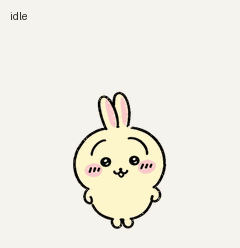
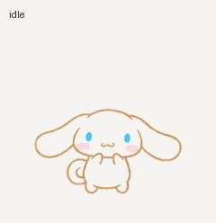

# Pet Studio — ChatGPT Pets 만들기

이름과 음성을 입력하고 나만의 애니메이션 펫을 만드는 **로컬 웹 도구**입니다.
참고 이미지·설명·스타일을 함께 지정할 수 있습니다. 기존 우사기와 시나모롤 파일도 포함합니다.

## 시작하기

macOS에서는 저장소의 `start.command`를 더블클릭하거나 터미널에서 실행하세요.

```sh
./start.command
```

브라우저에서 `http://127.0.0.1:8765`가 열립니다. Python 3.11+와 Pillow, 로그인된 Codex CLI, 활성화된 Pets 플러그인이 필요합니다.
ChatGPT 데스크톱 앱의 내장 CLI와 Python 런타임도 자동으로 찾습니다.
직접 환경을 준비하려면:

```sh
python3 -m venv .venv
.venv/bin/python -m pip install Pillow
.venv/bin/python studio/server.py --open
```

1. 이름을 입력하고 음성 파일을 선택합니다. 이미지·설명·스타일은 선택 사항입니다. 음성 없이도 제작할 수 있습니다.
2. **나만의 펫 만들기**를 누릅니다. 기존 Codex 로그인으로 Pets 제작 스킬과 내장 이미지 생성을 실행합니다.
3. 완성된 동작을 미리 보고 **이 펫을 Pets에 등록**을 누르거나 ZIP을 받습니다.
4. 음성이 있으면 **완료 알림 연결**에서 **Codex** 또는 **Claude Code**를 선택하고 **이 목소리를 완료 알림에 연결**을 누릅니다.

알림음은 macOS의 선택한 CLI 전체에 적용됩니다. Pets 서버에 음성을 등록하는 기능은 현재 제공하지 않습니다.
기존 알림 전달 명령과 다른 Codex 설정을 보존하고, 설정 백업과 **이전 알림 설정으로 복원** 기능을 제공합니다.
이 프로젝트에서 만든 기존 우사기 알림 래퍼도 인식해 두 소리가 겹치지 않도록 처리합니다.

## Claude·Grok 완료 알림

| 연결 대상 | 방식 | 현재 검증 |
| --- | --- | --- |
| Codex | 기존 notify 전달을 보존하는 로컬 음성 래퍼 | 실제 완료 알림·복원 확인 |
| Claude Code | 기존 Stop 훅에 음성 훅 하나 추가 | 실제 CLI 응답 완료·afplay 실행·원본 설정 복원 확인 |
| Grok 웹 (`grok.com`) | Chrome 확장으로 중지·전송 버튼 상태 감지 | 자동 테스트 통과, 실제 Chrome 설치·채팅 완료 검증 대기 |

Claude Code는 이 Mac의 `~/.claude/settings.json`에 완료 훅을 추가합니다. `CLAUDE_CONFIG_DIR`를 설정했다면 해당 폴더를 사용합니다.
다른 설정과 기존 훅을 유지하며, 연결을 해제하면 Pet Studio 훅만 제거합니다. 새 Claude Code 세션부터 확인하세요.
일반 `claude.ai` 웹 채팅과 Claude 데스크톱 앱에는 적용되지 않습니다.
구현은 공식 [Claude Code Stop 훅](https://code.claude.com/docs/en/hooks)을 사용하며 대화 본문·로그는 읽지 않습니다.

Grok은 웹 화면의 **Grok 확장 ZIP 받기**를 누르거나 [확장 소스 폴더](integrations/grok-web)를 사용하세요.
Chrome의 `chrome://extensions`에서 압축을 푼 폴더를 로드하고, 확장 옵션의 **Grok 웹 연결**에서 `grok.com` 사이트 권한을 허용합니다.
기본 “우나!” 음성이 포함돼 있으며 다른 음성(최대 5MB)으로 바꿀 수 있습니다. 서버나 API 키 없이 동작합니다.
음성·알림 설정·최근 재생 시각은 해당 브라우저에만 저장합니다. 대화 내용을 수집하거나 외부로 전송하지 않습니다.
Chrome 116 이상, 실행 중인 브라우저와 열린 Grok 탭이 필요합니다. 모바일 등 별도 Grok 앱에는 적용되지 않습니다.
화면·언어·모드 변화나 탭 절전으로 알림이 누락되거나 잘못 울릴 수 있는 실험 버전입니다. [설치·권한·검증 범위](integrations/grok-web/README.md)를 확인하세요.

## 제작 동작과 현재 검증 범위

서버는 공식 [Codex 비대화형 실행](https://learn.chatgpt.com/docs/non-interactive-mode)을 사용합니다.
제작은 여러 번의 이미지 생성과 행별 수정·검증을 포함하며 Codex 사용 한도가 적용됩니다.
`work-pets:create-pet` 스킬의 원본 제작 스크립트를 실행하고, 최종 구조·품질 검증을 서버에서 다시 실행합니다.
실패하거나 도구가 연결되지 않으면 이유와 작업 기록을 보존합니다. 등록 전 미리보기 단계에서 멈추고, 등록 성공 후 목록에서 같은 펫 ID를 확인합니다.
기존 활성 펫은 등록만으로 전환하지 않습니다.

2026-10-23, 우사기 참고 이미지와 MP3로 **새 펫 생성부터 계정 등록까지 실제 웹 화면에서 테스트했습니다.**
새 이미지 생성, 9개 동작·16방향, 구조·품질·Pets 검사, 미리보기 조작, ZIP 다운로드, 계정 등록과 목록 확인이 통과했습니다.
다운로드한 ZIP의 22개 파일을 검사하고, 아홉 GIF의 프레임 수와 스프라이트·음성 바이트 일치도 확인했습니다.
macOS 알림음 적용과 실제 완료 알림 실행 후 기존 Codex 설정을 복원했습니다. 기존 활성 펫은 유지됐습니다.
Python 자동 테스트 23개와 Grok 확장 테스트 15개가 통과합니다. 일부 중간 시선의 변화는 미세하며 검토된 연결 경고가 있어, 등록 전에 둘러보기 동작을 확인하세요.
환경 확인은 CLI·로그인·플러그인 설치·Pillow·검증 스크립트를 검사합니다. 이미지 생성과 Pets 계정 연결은 실제 실행 시 확인합니다.

입력과 작업은 `.pet-studio/jobs/`에 저장되며 Git에서 제외합니다. 제작할 때 이름·설명·참고 이미지가 Codex와 이미지 생성 서비스에 전달됩니다.
음성은 로컬 알림용 파일로 보관합니다. 원본 음성·로컬 로그·계정별 펫 ID는 Git에 자동으로 올리지 않습니다.
이 도구는 본인 컴퓨터의 `127.0.0.1` 전용이며 공용 서버 배포용으로 구성하지 않았습니다.

### 실행 옵션

| 설정 | 용도 |
| --- | --- |
| `CODEX_BIN` | 사용할 Codex 실행 파일의 절대 경로 |
| `PET_STUDIO_PYTHON` | `start.command`에서 사용할 Python 경로 |
| `PET_SKILL_DIR` | 설치된 `create-pet` 스킬 폴더 경로 |
| `PET_STUDIO_DATA` | 작업 저장 폴더 변경 |
| `--port 8766` | 다른 로컬 포트 사용 |

서버가 중단된 작업은 다시 시작할 때 `중단됨`으로 표시합니다. **이어서 만들기**로 승인된 이미지와 검증 기록을 보존한 채 진행할 수 있습니다.
실제 테스트 중 연결 오류에서 이 경로로 복구했고, 기존 기본 이미지와 아홉 동작의 해시가 모두 보존된 것을 확인했습니다.
생성 중에는 중지할 수 있고, 중복 등록을 방지하기 위해 등록 중에는 결과를 기다립니다.
등록 시도가 불확실하게 끝난 경우 자동 재생성하지 않으며, 로컬 작업 기록과 Pets 목록을 확인해야 합니다.
도구 권한 또는 이미지 생성 연결이 필요하면 Codex에서 연결한 뒤 다시 제작하세요. 별도 유료 API로 자동 전환하지 않습니다.

```sh
.venv/bin/python -m unittest discover -s studio/tests -v
node --test integrations/grok-web/tests/*.test.cjs
```

## 완성된 예시 — 우사기 & 시나모롤

우사기와 시나모롤을 바탕으로 제작한 팬메이드 애니메이션 펫 파일 모음입니다.
두 펫 모두 9가지 동작과 16방향 시선, 총 73프레임을 포함합니다.

| 먼작귀 우사기 | 시나모롤 |
| --- | --- |
|  |  |
| [파일·미리보기](pets/usagi) | [파일·미리보기](pets/cinnamoroll) |

## 다운로드와 사용

각 폴더의 `spritesheet.png`가 검증된 투명 배경 스프라이트입니다.
파일을 다운로드한 뒤 Pets 플러그인이 연결된 채팅에 첨부해 새 펫으로 등록해 달라고 요청할 수 있습니다.
이 저장소에는 계정별 펫 ID나 로그인 정보가 포함되어 있지 않습니다.

- [우사기 PNG](pets/usagi/spritesheet.png)
- [시나모롤 PNG](pets/cinnamoroll/spritesheet.png)
- [우사기 “우나!” 알림음](pets/usagi/audio/chiikawa-usagi-una.mp3)

## 스프라이트 규격

| 항목 | 값 |
| --- | --- |
| 형식 | 투명 PNG, v2 |
| 전체 크기 | 1536 × 2288 px |
| 셀 크기 | 192 × 208 px |
| 배열 | 8열 × 11행 |
| 사용 프레임 | 73개 |
| 동작 | idle, running-right, running-left, waving, jumping, failed, waiting, running, review |
| 시선 | 위에서 시작하여 시계 방향으로 16방향 |

`running`은 작업·생각 중인 상태이며, 이동은 `running-right`와 `running-left`입니다.
`previews/`에는 동작별 GIF, 전체 동작 GIF/MP4, 점프 전환과 시선 루프가 있습니다.
각 `validation.json`에 구조·동작 품질·방향 판독 검사 결과를 요약했습니다.
일부 중간 시선 변화와 대기·작업 동작의 차이는 부드러운 편입니다.

## 제작

사용자 참고 이미지와 내장 이미지 생성 도구로 제작했으며, 결정론적 추출·조립·검증을 거쳤습니다.
우사기는 Chiikawa, 시나모롤은 Sanrio의 캐릭터를 바탕으로 한 비공식 팬 제작물입니다.
